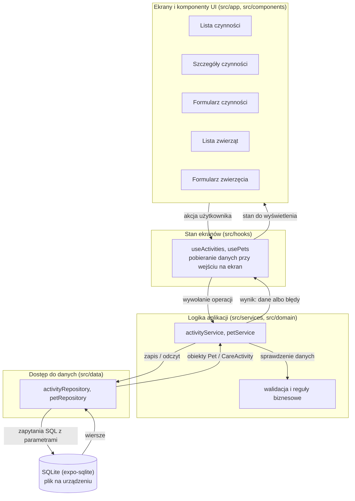
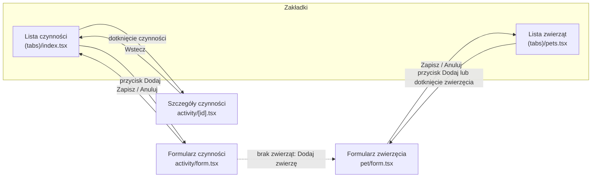

# Architektura aplikacji PetCare

## Struktura projektu

```text
src/
├── app/                        ekrany (expo-router)
│   ├── _layout.tsx             stos nawigacji, otwarcie bazy i migracja
│   ├── (tabs)/
│   │   ├── _layout.tsx         zakładki Czynności i Zwierzęta
│   │   ├── index.tsx           lista czynności
│   │   └── pets.tsx            lista zwierząt
│   ├── activity/
│   │   ├── [id].tsx            szczegóły czynności
│   │   └── form.tsx            formularz czynności
│   └── pet/
│       └── form.tsx            formularz zwierzęcia (dodawanie i edycja)
├── components/                 komponenty wielokrotnego użytku
│   ├── ChoiceChips.tsx         wybór jednej wartości z listy
│   ├── DateTimeField.tsx       wybór daty i godziny
│   ├── EmptyState.tsx          komunikat pustej listy lub błędu
│   ├── ErrorBanner.tsx         błąd całego formularza
│   ├── FormField.tsx           pole tekstowe z etykietą i błędem
│   ├── LoadingState.tsx        wskaźnik wczytywania
│   └── PrimaryButton.tsx       główny przycisk
├── constants/theme.ts          kolory, odstępy, rozmiary czcionek
├── domain/                     czysty TypeScript, bez Reacta i bazy
│   ├── types.ts                encje i rodzaje czynności
│   ├── validation.ts           reguły walidacji
│   └── dates.ts                formatowanie dat
├── services/                   operacje biznesowe
│   ├── petService.ts
│   ├── activityService.ts
│   └── result.ts               wynik operacji: dane albo błędy
├── hooks/                      połączenie ekranów z serwisami
│   ├── useServices.ts          składa serwisy z repozytoriami
│   ├── useFocusQuery.ts        pobieranie danych przy wejściu na ekran
│   ├── usePets.ts
│   └── useActivities.ts
└── data/                       dostęp do danych
    ├── database.ts             migracje i ustawienia SQLite
    ├── petRepository.ts
    └── activityRepository.ts
```

## Warstwy i przepływ danych



Zależności idą tylko w jedną stronę: ekrany korzystają z hooków, hooki z serwisów, a serwisy z repozytoriów i domeny. Domena nie importuje niczego z Reacta ani z bazy, więc reguły walidacji można testować w Node bez emulatora. Repozytoria są jedynym miejscem z zapytaniami SQL i to w nich nazwy kolumn (`pet_id`) zamieniają się na pola obiektów (`petId`).

## Model danych

| Encja | Pole | Typ | Wymagane | Znaczenie |
| --- | --- | --- | --- | --- |
| Pet (zwierzę), tabela `pets` | id | UUID (tekst) | Tak | lokalny identyfikator |
| | name | tekst, od 1 do 50 znaków | Tak | imię zwierzęcia |
| | species | tekst, od 1 do 50 znaków | Tak | gatunek, np. pies, kot |
| CareActivity (czynność opiekuńcza), tabela `care_activities` | id | UUID (tekst) | Tak | lokalny identyfikator |
| | petId | UUID, klucz obcy do `pets.id` | Tak | zwierzę, którego dotyczy czynność |
| | kind | tekst z listy: feeding, walk, vet_visit, medication, grooming, other | Tak | rodzaj czynności (w interfejsie po polsku) |
| | date | tekst ISO 8601 w UTC | Tak | data i godzina wykonania czynności |
| | description | tekst, od 1 do 500 znaków | Tak | opis czynności |

Jedno zwierzę ma wiele czynności (relacja 1:N). Spójność pilnują dwie warstwy. Serwis przed zapisem czynności sprawdza, czy zwierzę istnieje. Baza ma klucz obcy z `ON DELETE RESTRICT` oraz ograniczenie `CHECK` na rodzaj czynności. SQLite domyślnie nie sprawdza kluczy obcych, dlatego `database.ts` przy każdym otwarciu połączenia wykonuje `PRAGMA foreign_keys = ON`. Wersja schematu jest zapisana w `PRAGMA user_version`, więc kolejne migracje dopisuje się jako nowe kroki bez utraty danych.

## Zarządzanie stanem

Wartości pól formularza są stanem lokalnym ekranu (`useState`) i istnieją tylko do zapisu albo wyjścia z ekranu. Dane trwałe są w SQLite, które jest jedynym źródłem prawdy. Listy i szczegóły pobierają dane przez `useFocusQuery` przy każdym wejściu na ekran, więc po zapisie i powrocie zawsze pokazują aktualny stan bazy. Między ekranami przekazywany jest tylko identyfikator rekordu w trasie, a ekran sam wczytuje dane.

## Nawigacja



## Decyzje projektowe

| Decyzja | Wybrane rozwiązanie | Alternatywa | Uzasadnienie |
| --- | --- | --- | --- |
| Zarządzanie stanem | stan w hookach Reacta; listy pobierają dane z bazy przy każdym wejściu na ekran (`useFocusEffect`), a stan formularza jest lokalny w ekranie | Zustand (globalny magazyn stanu) | baza jest jedynym źródłem prawdy, więc dodatkowa kopia danych w pamięci nie jest potrzebna. To też jedna zależność mniej |
| Przechowywanie danych | SQLite przez `expo-sqlite`, wersja schematu w `PRAGMA user_version` | AsyncStorage (zapis klucz-wartość w JSON) | relacja zwierzę-czynności wymaga klucza obcego, a wyszukiwanie, filtrowanie i sortowanie to zapytania do bazy |
| Nawigacja | expo-router: zakładki Czynności i Zwierzęta, a w nich stos ekranów | React Navigation konfigurowana ręcznie | expo-router jest w szablonie projektu, trasy wynikają z nazw plików, a id rekordu przechodzi w adresie trasy |
| Separacja logiki od UI | ekrany wywołują serwisy, serwisy korzystają z repozytoriów, a repozytoria z SQLite; walidacja to czyste funkcje TypeScript | logika i zapytania bezpośrednio w komponentach ekranów | reguły da się testować bez emulatora i działają tak samo na wielu ekranach |

## Ograniczenia

- **Pobieranie przy każdym wejściu na ekran.** Listy wczytują dane z bazy za każdym razem, gdy ekran staje się aktywny. Przy kilkuset rekordach to nie problem, ale przy dużej liczbie danych potrzebne byłoby stronicowanie albo wspólny magazyn stanu.
- **Sortowanie po imieniu.** Zwierzęta są sortowane przez `COLLATE NOCASE` z SQLite, które rozpoznaje tylko litery ASCII. Imiona zaczynające się od polskiej litery, np. Łatka, mogą więc trafić na koniec listy.
- **Tylko Android.** Aplikacja jest sprawdzana tylko na Androidzie, a widok wyboru daty na iOS nie był testowany.