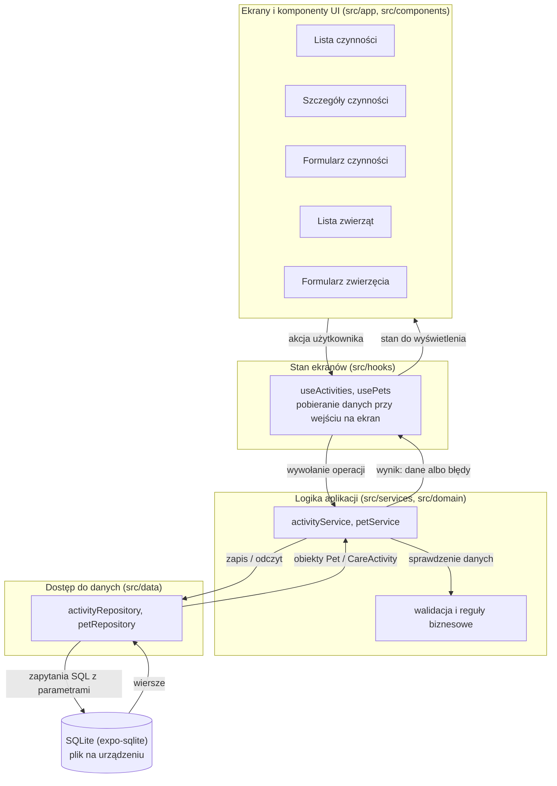
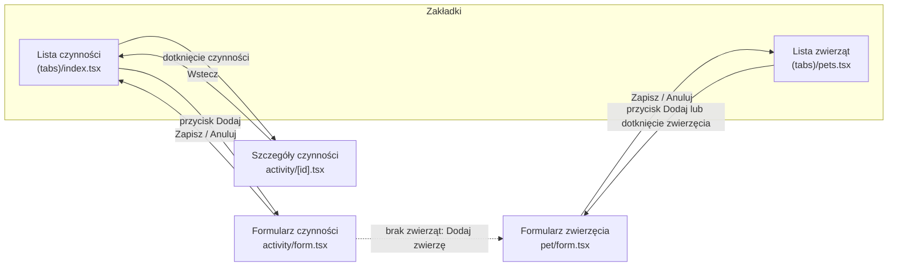
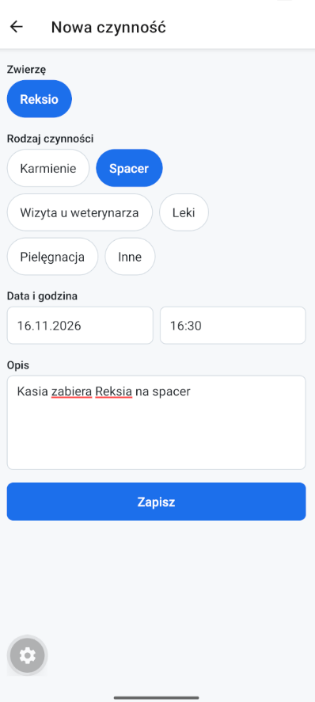
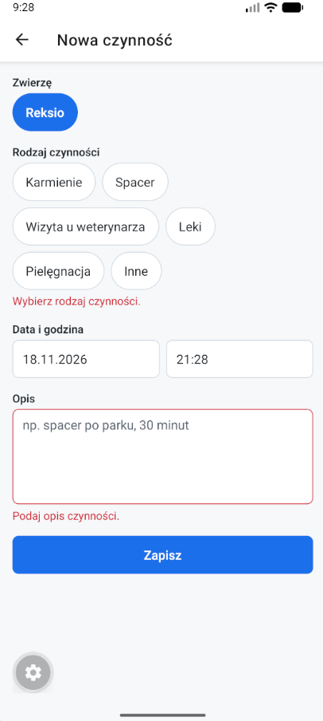
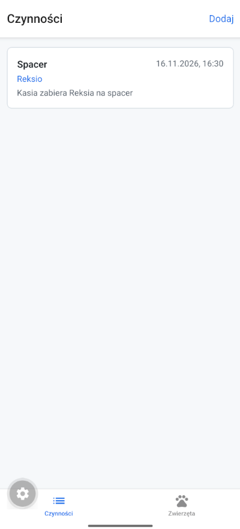
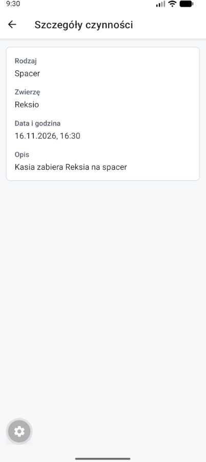
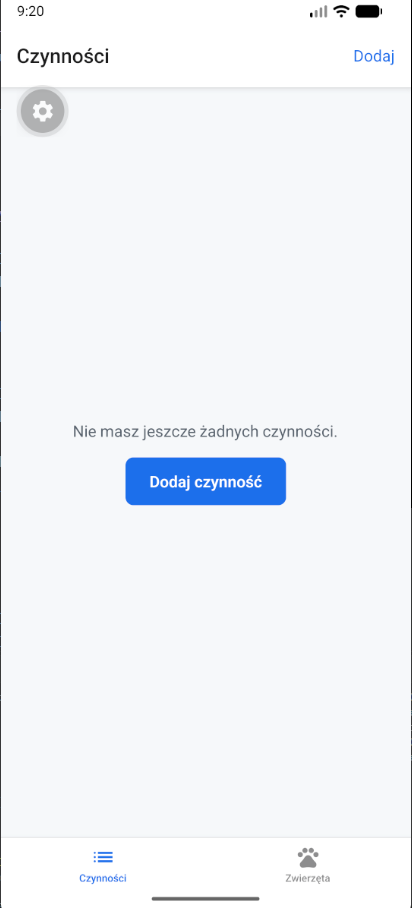

# Sprawozdanie - Laboratorium 2

**Przedmiot:** Budowa aplikacji mobilnych z użyciem technologii frontendowych  
**Student / identyfikator:** Marcin Mika / 147511  
**Projekt biznesowy:** MOB-029 - PetCare  
**Framework:** React Native (Expo SDK 58)  
**Data zajęć:** 2026-11-05  
**Repozytorium:** https://github.com/MarcinMikaa/semester-project-mobile-application  
**Commit / tag odpowiadający oddaniu:** tag `lab-02`

## T1. Analiza podejść do tworzenia aplikacji

| Wymaganie z projektu | Znaczenie dla wyboru technologii | Wniosek |
| --- | --- | --- |
| Dane muszą przetrwać restart, a czynność musi wskazywać istniejące zwierzę | potrzebna lokalna baza z kluczami obcymi | PWA odpada, bo przeglądarka może usunąć dane |
| Aplikacja działa bez internetu i bez backendu | aplikacja i dane muszą być na urządzeniu od pierwszego uruchomienia | aplikacja instalowana spełnia to od razu, PWA dopiero po pierwszym otwarciu online |
| Projekt robi jedna osoba na Windows, reguły mają mieć testy automatyczne | liczy się jeden kod i testy bez emulatora | podejście natywne odpada (dwa kody, iOS wymaga Maca) |

**Porównanie podejść i uzasadnienie:**

Podejście natywne wymaga dwóch osobnych kodów, a wersji na iOS nie zbuduję bez Maca. Aplikacja hybrydowa to strona w WebView, więc formularze i listy działają jak na stronie internetowej. PWA może stracić dane i działa offline dopiero po pierwszym otwarciu z internetem. React Native z Expo daje jeden kod w TypeScript, natywne widoki, bazę `expo-sqlite` i testy w Jest bez emulatora, więc wybór z laboratorium 1 ([ADR-001](../docs/technology-decision.md)) pozostaje aktualny.

**Wskazane źródła (dokumentacja, artykuły techniczne):**

1. MDN Web Docs, "Progressive web apps", https://developer.mozilla.org/en-US/docs/Web/Progressive_web_apps, dostęp 2026-11-05. PWA offline i zależność od przeglądarki.
2. MDN Web Docs, "Storage quotas and eviction criteria", https://developer.mozilla.org/en-US/docs/Web/API/Storage_API/Storage_quotas_and_eviction_criteria, dostęp 2026-11-05. Usuwanie danych strony przez przeglądarkę.
3. Apache Cordova, "Overview", https://cordova.apache.org/docs/en/latest/guide/overview/, dostęp 2026-11-05. Aplikacja hybrydowa jako strona w WebView.
4. Expo, "SQLite", https://docs.expo.dev/versions/latest/sdk/sqlite/, dostęp 2026-11-05. Lokalna baza z kluczami obcymi.

## T2. Projekt architektury aplikacji

### T2.1. Diagram architektury

Akcja użytkownika idzie z ekranu przez serwis do repozytorium i bazy, a wynik wraca tą samą drogą. Ekrany nie znają SQL, a repozytoria nie znają reguł biznesowych.

### T2.2. Model danych

| Encja | Pole | Typ | Wymagane | Znaczenie |
| --- | --- | --- | --- | --- |
| Pet (zwierzę), tabela `pets` | id | UUID (tekst) | Tak | lokalny identyfikator |
| | name | tekst, od 1 do 50 znaków | Tak | imię |
| | species | tekst, od 1 do 50 znaków | Tak | gatunek |
| CareActivity (czynność), tabela `care_activities` | id | UUID (tekst) | Tak | lokalny identyfikator |
| | petId | UUID, klucz obcy do `pets.id` | Tak | zwierzę, którego dotyczy czynność |
| | kind | tekst z listy: feeding, walk, vet_visit, medication, grooming, other | Tak | rodzaj czynności |
| | date | tekst ISO 8601 w UTC | Tak | data i godzina |
| | description | tekst, od 1 do 500 znaków | Tak | opis |

**Relacja i sposób zapewnienia spójności (np. usuwanie encji nadrzędnej):**

Jedno zwierzę ma wiele czynności (1:N). Serwis przed zapisem sprawdza, czy zwierzę istnieje. W bazie `petId` jest kluczem obcym z `ON DELETE RESTRICT`, więc nie da się usunąć zwierzęcia, które ma czynności. SQLite domyślnie nie sprawdza kluczy obcych, dlatego aplikacja przy starcie wykonuje `PRAGMA foreign_keys = ON`.

### T2.3. Decyzje projektowe

| Decyzja | Wybrane rozwiązanie | Alternatywa | Uzasadnienie |
| --- | --- | --- | --- |
| Zarządzanie stanem | hooki Reacta; listy pobierają dane z bazy przy każdym wejściu na ekran (`useFocusEffect`) | Zustand | baza jest jedynym źródłem prawdy, więc dodatkowy magazyn stanu nie jest potrzebny |
| Przechowywanie danych | SQLite (`expo-sqlite`), wersja schematu w `PRAGMA user_version` | AsyncStorage | potrzebny klucz obcy i zapytania do filtrowania i sortowania |
| Nawigacja | expo-router: zakładki Czynności i Zwierzęta oraz stos ekranów | React Navigation konfigurowana ręcznie | jest w szablonie projektu, trasy wynikają z nazw plików |
| Separacja logiki od UI | ekrany, serwisy, repozytoria; walidacja jako czyste funkcje | logika w komponentach ekranów | reguły można testować bez emulatora |

**Plik `docs/architecture.md`:** [docs/architecture.md](../docs/architecture.md)

## T3. Nawigacja i ekrany

**Schemat nawigacji:**

| Ekran | Plik / komponent | Przejście do / z ekranu | Dowód działania |
| --- | --- | --- | --- |
| Lista | `src/app/(tabs)/index.tsx` | do szczegółów i do formularza; powrót z formularza po zapisie | [tc-01-lista.png](assets/lab-02/tc-01-lista.png) |
| Szczegóły | `src/app/activity/[id].tsx` | z listy, z id w trasie; powrót do listy | [tc-03-szczegoly.png](assets/lab-02/tc-03-szczegoly.png) |
| Formularz | `src/app/activity/form.tsx` | z listy; po zapisie lub anulowaniu powrót do listy | [formularz.png](assets/lab-02/formularz.png) |

**Dlaczego taki układ nawigacji jest odpowiedni dla użytkownika?**

Zakładki dają szybki dostęp do czynności i zwierząt. W każdej zakładce działa zwykły stos ekranów, więc przycisk "wstecz" zachowuje się tak, jak na Androidzie się tego spodziewamy. Po zapisie aplikacja wraca do listy, gdzie od razu widać nowy rekord. Gdy nie ma żadnego zwierzęcia, formularz czynności odsyła do jego dodania.

## T4. Operacje Create i Read

**Powiązanie z wymaganiami biznesowymi (ID wymagań):** MOB-029-FR-01, FR-02, FR-03, FR-04, FR-08, FR-11, BR-01, BR-03, BR-04.

| Operacja | Lokalizacja kodu | Reguła walidacji / zachowanie | Wynik |
| --- | --- | --- | --- |
| Create | `src/app/activity/form.tsx`, `src/services/activityService.ts`, `src/data/activityRepository.ts` | wymagane zwierzę, rodzaj, data i opis; data nie z przyszłości; zwierzę musi istnieć | PASS (TC-01, TC-02) |
| Read (lista) | `src/app/(tabs)/index.tsx`, `src/hooks/useActivities.ts` | od najnowszej, z imieniem zwierzęcia; komunikat przy pustej liście | PASS (TC-01, TC-05) |
| Read (szczegóły) | `src/app/activity/[id].tsx`, `useActivity` | wczytanie po id z trasy; komunikat, gdy rekordu nie ma | PASS (TC-03) |

**Wyjaśnij przepływ danych po naciśnięciu przycisku „Zapisz”:**

1. Formularz trzyma wartości pól w `useState` i po naciśnięciu "Zapisz" wywołuje `activities.create(values)`.
2. Serwis uruchamia `validateActivity`. Przy błędach zwraca je do formularza, który pokazuje komunikaty pod polami, a nic nie trafia do bazy.
3. Przy poprawnych danych serwis sprawdza, czy zwierzę istnieje, nadaje czynności UUID, zamienia datę na ISO w UTC i przekazuje ją do `activityRepository.insert`.
4. Repozytorium wykonuje `INSERT` z parametrami, a formularz wraca do listy (`router.back()`).
5. Lista po powrocie na ekran pobiera dane z bazy przez `useFocusQuery`, więc nowy rekord jest od razu widoczny.

Przy błędzie zapisu formularz zostaje otwarty z wpisanymi danymi i pokazuje "Nie udało się zapisać. Spróbuj ponownie."

## T5. Weryfikacja działania i wnioski

Testy ręczne na emulatorze Androida w Expo Go, po wyczyszczeniu danych aplikacji.

| ID | Scenariusz | Oczekiwany rezultat | Wynik (PASS/FAIL) | Dowód / uwagi |
| --- | --- | --- | --- | --- |
| TC-01 | Dodanie poprawnego rekordu | Rekord jest zapisany i widoczny | PASS | [tc-01-lista.png](assets/lab-02/tc-01-lista.png) |
| TC-02 | Próba zapisu pustego wymaganego pola | Zapis zablokowany, komunikat | PASS | [tc-02-walidacja.png](assets/lab-02/tc-02-walidacja.png), komunikat "Wybierz rodzaj czynności." |
| TC-03 | Otwarcie szczegółów rekordu | Poprawne dane rekordu | PASS | [tc-03-szczegoly.png](assets/lab-02/tc-03-szczegoly.png) |
| TC-04 | Ponowne uruchomienie aplikacji | Rekord pozostaje dostępny | PASS | [tc-04-po-restarcie.png](assets/lab-02/tc-04-po-restarcie.png), po zamknięciu Expo Go |
| TC-05 | Brak rekordów | Czytelny stan pustej listy | PASS | [tc-05-pusta-lista.png](assets/lab-02/tc-05-pusta-lista.png) |

`npx tsc --noEmit` kończy się bez błędów. Testy automatyczne powstaną w laboratorium 4.

**Najważniejszy napotkany problem i sposób rozwiązania:**

VS Code pokazał 14 błędów TypeScript w pięciu plikach. Przyczyna była jedna: plik `useServices.ts` trafił do `src/services` zamiast `src/hooks`, więc hooki nie mogły go zaimportować i ekrany straciły typy danych. Po przeniesieniu pliku błędy zniknęły. Wcześniej podobny problem dał folder `components` w `src/app`, bo expo-router traktuje każdy plik w tym folderze jako ekran.

**Co wymaga dalszej pracy przed laboratorium 3?**

Edycja i usuwanie czynności, usuwanie zwierzęcia z blokadą, wyszukiwanie, filtrowanie i sortowanie, podsumowanie tygodnia oraz komunikat po zapisie.

**Wnioski (3–6 zdań, odnoszące się do własnej implementacji):**

Walidacja i serwisy są oddzielone od ekranów, więc reguły z karty są w jednym miejscu i w laboratorium 4 da się je przetestować bez emulatora. Klucz obcy w bazie i sprawdzenie w serwisie razem pilnują, żeby czynność zawsze miała zwierzę. Pobieranie danych przy wejściu na ekran wystarczyło, żeby lista po zapisie była aktualna. Najwięcej czasu zajęły błędy wynikające z położenia plików.

## Materiały dowodowe i historia pracy

- Issue(s): [#5](https://github.com/MarcinMikaa/semester-project-mobile-application/issues/5)
- Pull Request(s): [#6](https://github.com/MarcinMikaa/semester-project-mobile-application/pull/6)
- Commity związane z laboratorium:
  - `aa4456c` feat(navigation): add tabs and screen stack
  - `a9f6b68` chore(deps): add expo-sqlite, expo-crypto and datetimepicker
  - `bb9d998` feat(data): add database schema and repositories
  - `543a225` feat(domain): add validation and services
  - `cfa0d6c` feat(pets): create and list pets
  - `92388d4` feat(activities): create, list and show activity details
- Diagramy: [docs/architecture.md](../docs/architecture.md), sekcje T2.1 i T3
- Zrzuty ekranu: `reports/assets/lab-02/`
- Instrukcja uruchomienia: [README.md](../README.md)

## Użycie narzędzi AI (jeżeli dotyczy)

**Narzędzie i zakres wsparcia:** Wykorzystanie AI do pomocy przy tworzeniu schematów mermaid oraz stylizowania dokumentacji. Pomoc w wyjaśnieniu nowych zagadnień związanych z aplikacjami mobilnymi oraz rady odnośnie architektury.
**Jak zweryfikowano wynik:** `npx tsc --noEmit` i testy ręczne TC-01–TC-05 na emulatorze.  
**Elementy wykonane samodzielnie:** Pisanie całego kodu aplikacji i tworzenie dokumentacji.